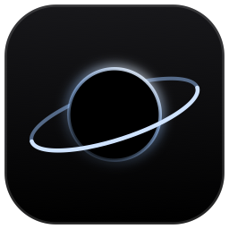

<p align="center"></p>

<h1 align="center">Saturn</h1>

<p align="center">Agents propose, rails verify, humans approve.</p>

Saturn is a native macOS app for solo developers that runs a crew of Claude Code agents on your project. You chat with one Lead. It plans the work and starts builders and checkers, each in its own git worktree. Nothing reaches `main` without your approval.

## What you get

- **One chat with the Lead.** You talk only to the Lead. Questions, approvals and failures come to you in the chat they belong to.
- **Every agent isolated.** Each coding agent works in its own git worktree and branch under `.crew/`, out of your own `git status`.
- **Checks before review.** Saturn runs your project's format, lint, typecheck and test commands itself, outside the agent's session. Work reaches you only once they pass, and retries are capped.
- **Protected tests.** Agents can't edit or disable the checks that judge them. Any change to a protected file is pinned for you to review.
- **AI review that points, not blocks.** Reviewer agents leave pins on the lines you should read. Only you approve.
- **Specs before runs.** The Lead drafts a short spec with scope and acceptance criteria. The spec opens in [Lavish](https://github.com/kunchenguid/lavish-axi), where you review and annotate it before any work starts.
- **Config in your repo.** Roles, workflows and checks live in `.saturn/`, versioned with your code.
- **Your own Claude account.** Saturn drives the `claude` CLI with your Claude sign-in or your own API key. No reselling.
- **Local-first.** A finished run merges into your base branch on your Mac. You push when you choose.
- **Native macOS.** Dark and light, with keyboard shortcuts and a ⌘K palette.

## Getting started

### Requirements

- macOS 26 or later
- `git`
- The [Claude Code](https://docs.anthropic.com/en/docs/claude-code) `claude` CLI, signed in

### Install

Downloads are coming. There are no releases yet, so build from source for now:

```sh
brew install xcodegen
git clone https://github.com/brenodega28/saturn.git
cd saturn
xcodegen generate
open Saturn.xcodeproj
```

Then build and run the **Saturn** scheme in Xcode 26 or later.

### How it works

1. **Open a project.** Pick a folder or clone a repository from the Welcome screen.
2. **Start a chat.** Tell the Lead what you want done.
3. **Review the spec.** The Lead drafts a spec naming the work and the workers, and it opens in Lavish. Annotate it or ask for changes.
4. **Start the run.** Builders work in their own worktrees. Saturn runs the checks, and reviewers pin what needs your eyes.
5. **Approve.** Review the changes, approve, and the run merges locally. Push to origin from the chat.

## Acknowledgements

Much of Saturn's approach is inspired by the teachings of [Kun Chen](https://github.com/kunchenguid). Saturn integrates his [Lavish](https://github.com/kunchenguid/lavish-axi) editor for spec review.

## Development

Requirements: macOS 26, Xcode 26 or later, [XcodeGen](https://github.com/yonaskolb/XcodeGen) (`brew install xcodegen`), and `git` and the `claude` CLI on the machine running the app.

```sh
xcodegen generate
open Saturn.xcodeproj
```

`project.yml` is the source of truth; `Saturn.xcodeproj` is generated and git-ignored. Re-run `xcodegen generate` after adding or removing files.

Engine tests run without Xcode:

```sh
swift test --package-path Packages/SaturnCore
```

The plan and design live in [spec/mission.md](spec/mission.md) and [spec/roadmap.md](spec/roadmap.md).

### Layout

```
Saturn/              macOS app target (SwiftUI)
Packages/SaturnCore  UI-free engine: storage, git, worktrees, environment checks, Keychain
Packages/SaturnUI    shared SwiftUI components and theme
Configs/             build settings (copy Local.xcconfig.example to Local.xcconfig for Sparkle keys)
scripts/release.sh   Developer ID archive, notarization, DMG and Sparkle appcast
```

The **Debug** menu has a Worktrees window for creating and removing worktrees under `.crew/`.

### Releases

`scripts/release.sh` (run by `.github/workflows/release.yml` on `v*` tags) needs a Developer ID Application certificate and these values:

| Name | Kind | Purpose |
| --- | --- | --- |
| `DEVELOPER_ID_P12_BASE64`, `DEVELOPER_ID_P12_PASSWORD` | secret | Developer ID Application certificate |
| `NOTARY_APPLE_ID`, `NOTARY_TEAM_ID`, `NOTARY_PASSWORD` | secret | `notarytool` credentials (app-specific password) |
| `SPARKLE_PRIVATE_KEY` | secret | EdDSA private key from Sparkle's `generate_keys` |
| `SPARKLE_PUBLIC_ED_KEY`, `SPARKLE_FEED_URL`, `SPARKLE_DOWNLOAD_URL_PREFIX` | variable | Public key, appcast URL, and where DMGs are hosted |

The in-app updater stays off until a build has an `https` feed URL and a public key.
